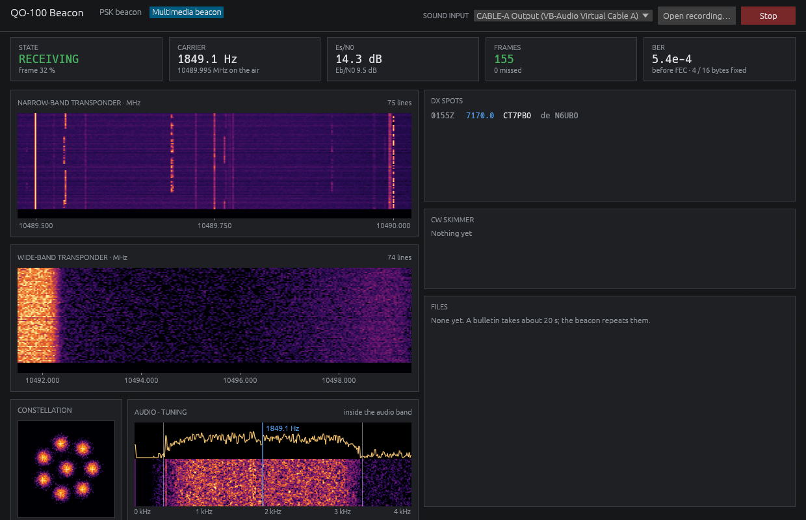

# QO-100 Beacon

Decodes the 400 bit/s PSK beacon of the QO-100 (Es'hail 2) amateur satellite,
and its 2400 baud multimedia beacon, from a sound card or a WAV recording.


## Use

1. Tune a receiver or WebSDR to the middle beacon, 10489.750 MHz, in USB, so
   the beacon sits between about 300 Hz and 3.7 kHz of audio.
2. Run `qo100-beacon`, pick the sound input and press **Listen**. Or press
   **Open recording…** for a WAV file.

A frame takes 10 seconds and one comes every 25. Its text appears as it
arrives; the bars turn green when the CRC and the FEC block check.

## The multimedia beacon



The second page, **Multimedia beacon**, reads the 2400 baud 8APSK beacon at
10489.995 MHz (AMSAT-DL's HSmodem by DJ0ABR): the two transponders'
waterfalls, DX spots and the AMSAT bulletins it sends as files.

1. Tune to about 10489.9930 MHz in USB with the widest filter there is
   (4 kHz or more), so the signal's centre is near 2 kHz of audio.
2. The small spectrum at the bottom marks the carrier and the signal's two
   edges, and says which way to tune if an edge is cut off.

Es/N0 is measured at the decided points. BER is the channel's bit error
rate before error correction, counted from what the Reed-Solomon code put
right. Both beacons are looked for all the time, whichever page is open.

## Good to know

- The beacon sends text only at present. The dials show voltages and
  temperature if it sends them again, as it did in 2019. Their green bands
  are set around those 2019 values; AMSAT has not published the real limits.
- The satellite picture is worked out from the time, not from telemetry.
- After each frame the beacon repeats the first half of the block with
  error correction. That FEC block is decoded too, and fills in when a
  frame is missed or fails its CRC.
- Old recordings of AO-40 (the same format) decode too, with its
  voltages, currents, temperatures and spin read from the A block.

## Build

```bash
cargo build --release
```

Needs Rust 1.95. On Linux also the ALSA and X11/Wayland development packages
(see `.github/workflows/ci.yml`).

## Credits and licence

The frame format is AO-40's uncoded telemetry, as described by Daniel Estévez
EA4GPZ and implemented in gr-satellites. The receiver is the one in
[DecSAT](https://github.com/CasualArclamp/DecSAT).

The multimedia beacon's format is ported from Kurt Moraw DJ0ABR's HSmodem
(GPL, [dj0abr/SSB_HighSpeed_Modem](https://github.com/dj0abr/SSB_HighSpeed_Modem)),
with Daniel Estévez's write-up of decoding it in GNU Radio as a guide.

GPL-3.0-or-later.
