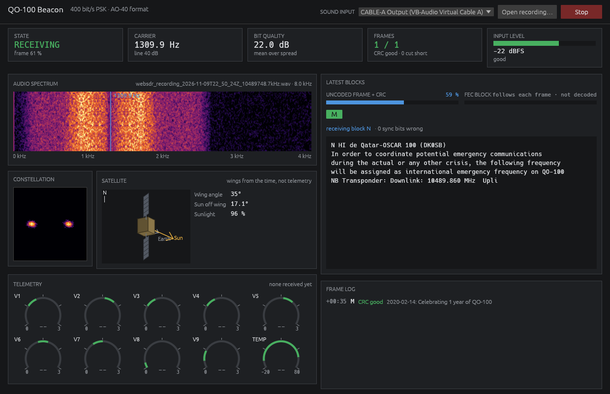

# QO-100 Beacon

Decodes the 400 bit/s PSK beacon of the QO-100 (Es'hail 2) amateur satellite
from a sound card or a WAV recording.



## Use

1. Tune a receiver or WebSDR to the middle beacon, 10489.750 MHz, in USB, so
   the beacon sits between about 300 Hz and 3.7 kHz of audio.
2. Run `qo100-beacon`, pick the sound input and press **Listen**. Or press
   **Open recording…** for a WAV file.

A frame takes 10 seconds and one comes every 25. Its text appears as it
arrives; the bar turns green when the CRC checks.

## Good to know

- The beacon sends text only at present. The dials show voltages and
  temperature if it sends them again, as it did in 2019. Their green bands
  are set around those 2019 values; AMSAT has not published the real limits.
- The satellite picture is worked out from the time, not from telemetry.
- The FEC block between frames is not decoded.

## Build

```bash
cargo build --release
```

Needs Rust 1.95. On Linux also the ALSA and X11/Wayland development packages
(see `.github/workflows/ci.yml`).

## Credits and licence

The frame format is AO-40's uncoded telemetry, as described by Daniel Estévez
EA4GPZ and implemented in gr-satellites. The receiver is the one in
[DecSAT](https://github.com/CasualArclamp/DecSAT).

GPL-3.0-or-later.
